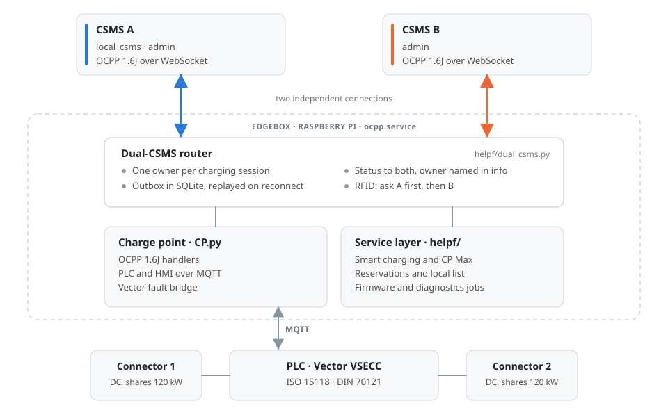
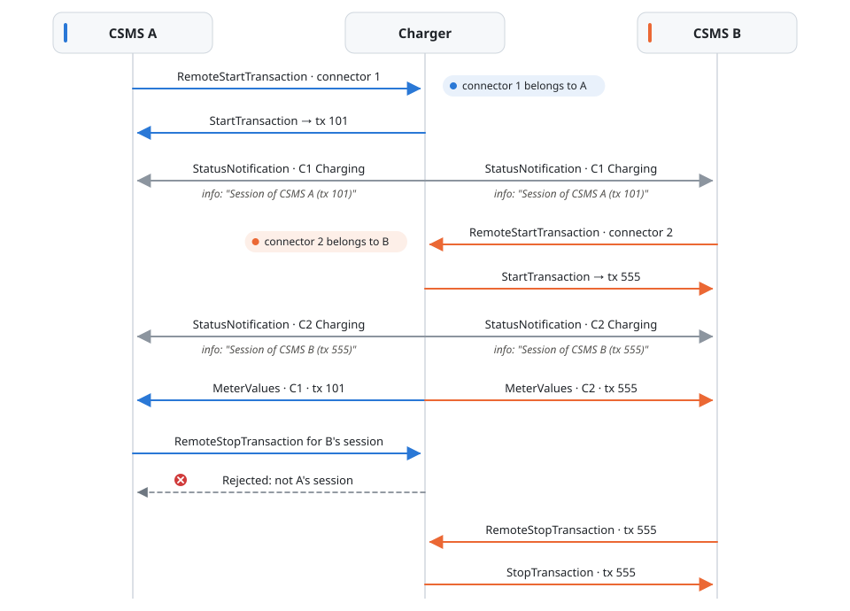
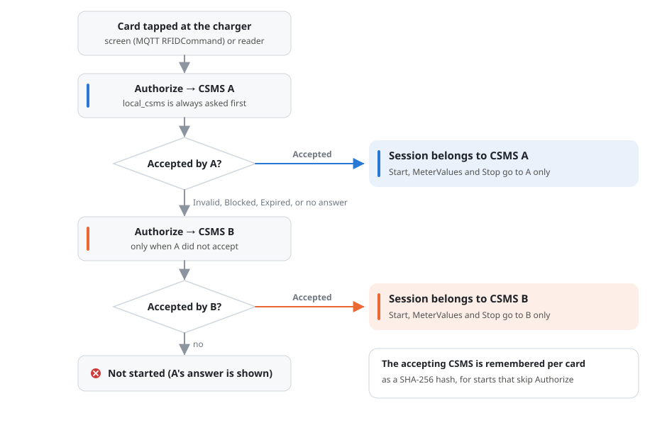
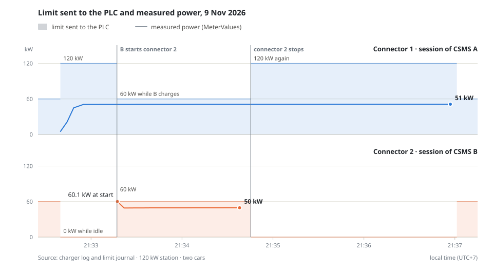

<div align="center">

# OCPP_CP_DUAL_CSMS

**One OCPP 1.6J charge point. Two Central Systems. No duplicate sessions.**

[](#message-routing)
[](#requirements)
[](#run-the-tests)
[](LICENSE)

</div>

<p align="center">
  <picture>
    <source media="(prefers-color-scheme: dark)" srcset="docs/images/architecture-dark.svg">
    
  </picture>
</p>

`CP.py` is the charge point controller of a DC charger. It runs on a Raspberry Pi "Edgebox" next to the PLC. This project adds a router that keeps the charger connected to **two CSMS at the same time**, for example the operator's own platform and a utility or roaming platform.

Both CSMS see every connector status. Each charging session belongs to exactly one of them, so energy and revenue are never counted twice.

The code runs on a 120 kW, two-connector DC charger in factory testing, connected to two production CSMS platforms.

## Contents

- [Features](#features)
- [How it works](#how-it-works)
  - [Message routing](#message-routing)
  - [Session ownership](#session-ownership)
  - [RFID cards](#rfid-cards)
  - [Power sharing](#power-sharing)
  - [Outages and restarts](#outages-and-restarts)
- [Getting started](#getting-started)
- [Configuration](#configuration)
- [Deploying to an Edgebox](#deploying-to-an-edgebox)
- [Project layout](#project-layout)
- [Security](#security)
- [Release history](#release-history)
- [License](#license)

## Features

- **Two live CSMS connections.** Each CSMS has its own OCPP 1.6J WebSocket link, BootNotification, heartbeat interval and reconnect loop. One CSMS going offline never blocks the other.
- **Exactly one owner per session.** StartTransaction, MeterValues and StopTransaction go only to the CSMS that owns the session. Transaction IDs are mapped separately for each CSMS.
- **Status for both.** StatusNotification goes to both CSMS. While a connector has a session, the `info` field names its owner, for example `Session of CSMS B (tx 555)`.
- **Remote control with guard rails.** Either CSMS can start a free connector. Only the owner can stop a session.
- **RFID across both platforms.** A card tapped at the charger is checked with CSMS A first, then with CSMS B. The session belongs to the CSMS that accepted the card.
- **Shared administration.** `admin_csms` lists the CSMS allowed to change configuration, charging profiles, availability and local lists, and to reset the charger or request firmware updates and diagnostics.
- **Smart charging.** The station rating is split between the connectors that are charging. `ChargePointMaxProfile` (CP Max) caps the whole station. Limits are always lowered before they are raised.
- **Survives outages.** Messages for an unreachable CSMS wait in SQLite and are delivered in order when it reconnects. Sessions and ownership survive a restart.
- **Simulator without hardware.** `live_dual_simulator.py` runs the full protocol stack against real CSMS using test charger IDs.
- **526 offline tests** cover routing, ownership, smart charging, restarts and the `CP.py` hooks. They use only `127.0.0.1`.

## How it works

### Message routing

| Message | Sent by | Goes to |
|---|---|---|
| BootNotification, Heartbeat | charger | each CSMS on its own link |
| StatusNotification | charger | both CSMS; `info` names the session owner |
| Authorize for a card tapped at the charger | charger | CSMS A first, then CSMS B (see [RFID cards](#rfid-cards)) |
| StartTransaction, MeterValues, StopTransaction | charger | the session owner only |
| DataTransfer, vendor `EDS` (ISO 15118 session data) | charger | the owner of the transactions it refers to |
| FirmwareStatusNotification, DiagnosticsStatusNotification | charger | the CSMS that requested the job |
| Any other charger message | charger | `local_csms` |
| RemoteStartTransaction | either CSMS | accepted on a free connector; the caller becomes the owner |
| RemoteStopTransaction | either CSMS | accepted only for the caller's own session |
| ReserveNow, CancelReservation | either CSMS | a reservation holds the connector for the CSMS that made it |
| Reset, ChangeConfiguration, SetChargingProfile, ClearChargingProfile, ClearCache, SendLocalList, UnlockConnector, ChangeAvailability, GetDiagnostics, UpdateFirmware | a CSMS in `admin_csms` | rejected from any other CSMS |

The example below shows two sessions at once. Connector 1 belongs to CSMS A and connector 2 belongs to CSMS B:

<p align="center">
  <picture>
    <source media="(prefers-color-scheme: dark)" srcset="docs/images/session-routing-dark.svg">
    
  </picture>
</p>

### Session ownership

- **RemoteStartTransaction:** the CSMS that sent the command owns the session.
- **Card or AutoCharge (EVCCID) at the charger:** the CSMS that accepted the card owns the session.
- **Authorize while handling a CSMS command** (for example with `AuthorizeRemoteTxRequests`) goes only to that CSMS.
- **Reset or UnlockConnector from an admin** can end the other CSMS's session. Its StopTransaction still goes to the owner.
- **Charger-wide settings are shared.** Configuration keys, charging profiles, the local list and availability are one set for the whole charger, so a change by either admin applies to both.

### RFID cards

<p align="center">
  <picture>
    <source media="(prefers-color-scheme: dark)" srcset="docs/images/rfid-authorization-dark.svg">
    
  </picture>
</p>

- Any answer other than `Accepted` from CSMS A, or no answer within `request_timeout` (15 s by default), moves on to CSMS B.
- A card that both CSMS know always belongs to A, because A is asked first.
- The accepting CSMS is remembered per card as a SHA-256 hash (up to 5,000 cards). That memory is used when the charger skips Authorize: for a card in the authorization cache, or a second tap within 5 minutes.
- The router never stores or logs card numbers.

### Power sharing

Measured on the factory test charger on 9 Nov 2026. CSMS A charges a car on connector 1, then CSMS B starts a second car on connector 2:

<p align="center">
  <picture>
    <source media="(prefers-color-scheme: dark)" srcset="docs/images/power-sharing-dark.svg">
    
  </picture>
</p>

| Time (UTC+7) | Event | Connector 1 limit | Connector 2 limit | Measured |
|---|---|---|---|---|
| 21:32:39 | CSMS A starts connector 1 | 120 kW | 0 kW | connector 1 ramps to 51 kW |
| 21:33:17 | CSMS B starts connector 2 | 60 kW | 60 kW | connector 1: 51 kW; connector 2: 60.1 kW, then 50 kW |
| 21:34:45 | connector 2 stops | 120 kW | 0 kW | connector 1: 51 kW |
| 21:37:01 | connector 1 stops | 60 kW | 60 kW | no session |

- **Sharing.** The station rating is shared by the connectors that have a session. An idle connector is held at 0 W while the other one charges.
- **Idle charger.** When nothing is charging, each connector keeps its own share (60 kW here), so a new session can start right away.
- **Lower before raise.** Every change lowers one connector before raising the other, so the total never exceeds the station rating.
- **Not yet tested at the cap.** Both cars asked for about 50 kW, so the 60 kW share was reached only at connector 2's first sample. A CP Max below the cars' demand is the next test.

### Outages and restarts

- **Queued while offline.** StartTransaction, MeterValues and StopTransaction for an unreachable CSMS wait in an SQLite outbox and are delivered in order when it reconnects.
- **Bounded meter queue.** MeterValues are capped at `meter_queue_limit` per CSMS (2,000 by default). The oldest samples are dropped first, with a warning in the log.
- **Status resent.** After a reconnect, the latest status of every connector is sent again.
- **No double execution.** A CSMS command repeated with the same message ID gets the stored answer instead of running twice.
- **State survives restarts.** Sessions, owners and the transaction ID mapping live in `dual_csms_state.sqlite3`.

## Getting started

### Requirements

- Python 3.11 or newer.
- The `ocpp` and `websockets` packages. The tests pass with ocpp 2.1.0 and websockets 15.0.1, and with the Edgebox versions (ocpp 1.0.0, websockets 17.1).
- On the Edgebox, `CP.py` also needs paho-mqtt, pytz, psutil, sdnotify and RPi.GPIO. Telegram alerts also need requests.

### Run the tests

```bash
git clone https://github.com/SukritJaAIproject/OCPP_CP_DUAL_CSMS.git
cd OCPP_CP_DUAL_CSMS
python3 -m venv .venv && . .venv/bin/activate
pip install -r requirements-test.txt
python -m pytest tests -q
```

### Try it without hardware

The simulator connects to real CSMS with test charger IDs. Register those IDs on both CSMS first, and never reuse the ID of a real charger.

```bash
pip install -r requirements-simulator.txt
python live_dual_simulator.py --config dual_csms_simulator_config.json --state-dir simulator_state --full-protocol
```

The simulator only starts with a config that contains `"simulator": true`. On Windows, `RUN_WINDOWS_SIMULATOR_R31.cmd` does the same.

## Configuration

### `dual_csms_config.json`

```json
{
  "enabled": true,
  "local_csms": "A",
  "admin_csms": ["A", "B"],
  "request_timeout": 15,
  "reconnect_seconds": 5,
  "meter_queue_limit": 2000,
  "servers": [
    {"name": "A", "enabled": true, "url": "wss://csms-a.example.com/ocpp/CP-A-0001"},
    {"name": "B", "enabled": true, "url": "ws://csms-b.example.com:9000/ocpp/CP-B-0001"}
  ]
}
```

| Key | Default | Meaning |
|---|---|---|
| `enabled` | `true` | Turns the router on. |
| `local_csms` | (required) | Asked first for cards tapped at the charger. Also receives charger messages that belong to no session. |
| `admin_csms` | `"A"` | One CSMS name or a list of names allowed to send the admin commands. |
| `request_timeout` | `15` | Seconds to wait for a CSMS answer (0.2 to 300). |
| `reconnect_seconds` | `5` | Seconds between reconnect attempts (0.05 to 300). |
| `meter_queue_limit` | `2000` | MeterValues kept per CSMS while it is offline (1 to 100,000). |
| `servers[].name` | (required) | Unique name, for example `A` or `B`. |
| `servers[].url` | (required) | `ws://` or `wss://` URL ending with the charger ID. |
| `servers[].enabled` | `true` | Turns one connection on or off. |
| `servers[].username_env`, `password_env` | none | Names of environment variables that hold HTTP Basic credentials. Requires `wss://`. |
| `servers[].client_cert`, `client_key`, `ca_file` | none | TLS client certificate, key and CA file. Requires `wss://`. |

One or two servers can be enabled. Their URLs must differ. Credentials are never accepted inside a URL.

### `ocpp_services_config.json`

| Key | Meaning |
|---|---|
| `station_rated_power_w` | Station nameplate power shared by the connectors. |
| `rated_power_w`, `rated_current_a` | Highest power and current one connector may get. |
| `firmware_mode` | `download_and_stage`: firmware is downloaded and checked, never installed automatically. |
| `transfer.allowed_hosts`, `transfer.allow_http_hosts` | Hosts allowed for firmware downloads and diagnostics uploads. Plain HTTP is allowed only for the second list. |
| `trusted_firmware_sha256` | Optional SHA-256 per firmware URL. |

The installer sets the three rating keys from `RATED_W` and `RATED_A`.

### Site settings in `CP.py`

`OCPP_BROKER`, `OCPP_PORT`, `OCPPSTATION` and `EV_STOP_V2G_TOPIC` describe the local MQTT setup. The installer keeps the values already on the charger.

### Environment variables

| Variable | Used for |
|---|---|
| `TELEGRAM_BOT_TOKEN`, `TELEGRAM_CHAT_ID` | Optional Telegram alerts. Without them, alerts are skipped. |
| Names in `username_env` / `password_env` | HTTP Basic credentials for a `wss://` CSMS connection. |

Set them in the systemd unit of the service, for example with `Environment=`.

## Deploying to an Edgebox

`deploy/edgebox_r31.sh` runs on the Raspberry Pi as the `pi` user. It expects a release ZIP next to it: one folder with these files plus `MANIFEST_SHA256.json`. Set `PKG_NAME` and `PKG_SHA` at the top of the script to match your ZIP.

| Command | What it does |
|---|---|
| `bash ~/edgebox_r31.sh check` | Read-only report: Python packages, the running `CP.py` and its service, installed file versions and site settings. |
| `bash ~/edgebox_r31.sh stage` | Unpacks and verifies the ZIP, then runs the offline tests as the service user. The charger keeps running. |
| `RATED_W=120000 bash ~/edgebox_r31.sh install /home/pi/ocpp` | Takes a backup, stops the service, installs, keeps the site settings and existing configs, then starts the service and shows whether both CSMS register. |
| `bash ~/edgebox_r31.sh diag` | Read-only: sessions and owners, card checks, limits sent to the PLC, last status per connector, faults. |
| `bash ~/edgebox_r31.sh logs /home/pi/ocpp` | Registration lines from the newest charger log. |
| `bash ~/edgebox_r31.sh zip` | Snapshot of the whole folder while the charger runs. SQLite files are copied consistently. |
| `bash ~/edgebox_r31.sh rollback <backup> /home/pi/ocpp` | Restores a backup taken by `install`. |

## Project layout

```text
CP.py                         charge point controller: OCPP handlers, PLC/HMI bridge, Vector faults
helpf/
  dual_csms.py                dual-CSMS router: connections, sessions, outbox, ownership
  ocpp_runtime.py             glue between CP.py, the router and the services
  ocpp_services.py            reservations, availability, local list, firmware and diagnostics jobs
  ocpp_smart_charging.py      charging profiles and the per-connector limit sent to the PLC
  plc_function.py             PLC MQTT client
  v2g_datatransfer.py         ISO 15118 / DIN data bridge
  stop_pin_config.py          stop-PIN settings
dual_csms_config.json         which CSMS to connect to (placeholders)
ocpp_services_config.json     station rating, transfer rules
live_dual_simulator.py        protocol simulator without hardware
tests/                        526 offline tests
tools/                        protocol harness, CSMS API client, simulator controls
deploy/edgebox_r31.sh         Edgebox install helper
docs/images/                  diagrams in this README
R31*_*.md, README_*_TH.md     release notes and operator guides (Thai)
CHANGES_*.patch               diff between consecutive releases
```

## Security

- **Encrypt and authenticate the links.** Plain `ws://` OCPP 1.6J has no authentication: anyone who knows the URL can connect as the charger. Use `wss://` with HTTP Basic authentication (security profile 2) or client certificates (profile 3). Both are supported per server.
- **No secrets in this repository.** CSMS addresses, the MQTT broker and charger IDs are placeholders. Credentials come from environment variables.
- **Keep logs private.** Charger logs contain card numbers from Authorize and StartTransaction messages. Treat logs and `zip` snapshots as private data.
- **Firmware is never installed automatically.** It is downloaded only from allowed hosts, checked for size and SHA-256, and staged.

## Release history

| Release | Change |
|---|---|
| R3.1 | Dual-CSMS router, CP Max support, Windows simulator |
| R3.1.1 | Logs the reason whenever the charger refuses a RemoteStart |
| R3.1.2 | A plugged-in car in SuspendedEV no longer blocks RemoteStart. Vector faults are no longer overwritten at boot |
| R3.1.3 | `admin_csms` can list several CSMS, so B can send the admin commands too |
| R3.1.4 | Cards are checked with CSMS A first, then CSMS B. The session belongs to the CSMS that accepted the card |
| R3.1.5 | Status `info` names the CSMS that owns each session, for both CSMS |

Detailed notes for each release (in Thai) are in `R31x_CHANGES_TH.md`. The exact diff between releases is in `CHANGES_<from>_TO_<to>.patch`.

## License

[MIT](LICENSE)
